# Linux Backup Lab – PHP Web App with Automated Backup

Automated, verified backup of a PHP web application and its SQLite database on Ubuntu Server, scheduled with cron and tested with a full restore.

## Goal

- Host a small PHP web app that stores data in a database
- Back up both the **database** and the **site files** automatically every night
- Keep backups for **7 days** (retention)
- **Prove the backup works** by deleting the database and restoring it
- Copy every backup to a **second server** (off-site) with rsync over SSH

## Environment

| Component | Details |
|---|---|
| Hypervisor | Hyper-V (Windows 11 host) |
| Web server VM | `web01` – Ubuntu Server 26.04 LTS, Gen 2, 2 GB RAM, 30 GB disk, `192.168.0.138` |
| Backup server VM | `backup01` – Ubuntu Server 26.04 LTS, Gen 2, 1 GB RAM, 20 GB disk, `192.168.0.140` |
| Network | External virtual switch, IPs from DHCP |
| Web server | Apache 2.4 |
| Language | PHP 8.5 |
| Database | SQLite 3 |
| Access | SSH from Windows PowerShell |

```bash
sudo apt update
sudo apt install apache2 php libapache2-mod-php php-sqlite3 sqlite3 -y
sudo timedatectl set-timezone Europe/Stockholm
```

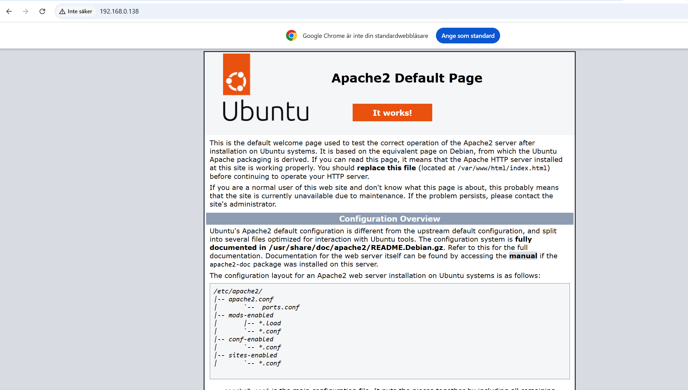

## 1. The application

A simple notes app ([`app/index.php`](app/index.php)) where the user can write and save notes.

- Site files: `/var/www/html/mysite/`
- Database: `/var/www/data/notes.db` — stored **outside the web root** so it can't be downloaded through the browser
- Uses prepared statements (SQL injection protection) and `htmlspecialchars` (XSS protection)

```bash
sudo mkdir -p /var/www/html/mysite /var/www/data
sudo chown -R www-data:www-data /var/www/data
```

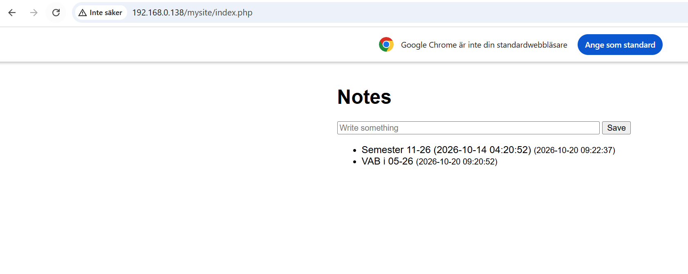

Verifying that the data is stored in the database:

```bash
sudo sqlite3 /var/www/data/notes.db "SELECT * FROM notes;"
```

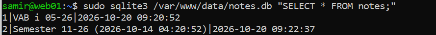

## 2. Backup script

Script: [`scripts/backup-site.sh`](scripts/backup-site.sh), installed at `/usr/local/bin/backup-site.sh`.

| Step | Command | Why |
|---|---|---|
| Database backup | `sqlite3 $DB ".backup ..."` | Consistent copy even while the site is in use (a plain `cp` can catch the file mid-write) |
| Site files | `tar -czf ...` | Compressed archive of the PHP files |
| Retention | `find $DEST -type f -mtime +7 -delete` | Removes backups older than 7 days so the disk doesn't fill up |
| Logging | `echo ... >> /var/log/backup-site.log` | Record of every run for follow-up |

File names include date and time (`notes_2026-10-20_1130.db`), so each backup is unique and easy to find.

```bash
sudo mkdir -p /backup
sudo chmod 700 /backup                  # only root can read the backups
sudo chmod +x /usr/local/bin/backup-site.sh
sudo /usr/local/bin/backup-site.sh      # manual test run
sudo ls -lh /backup
sudo cat /var/log/backup-site.log
```

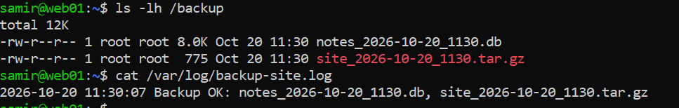

## 3. Automation with cron

```bash
sudo crontab -e
```

```
0 2 * * * /usr/local/bin/backup-site.sh
```

Runs every night at 02:00 as root.

**Testing the schedule:** to verify cron without waiting until night, the schedule was temporarily set to every 2 minutes (`*/2 * * * *`). A new backup appeared every 2 minutes, after which the schedule was changed back to `0 2 * * *`.

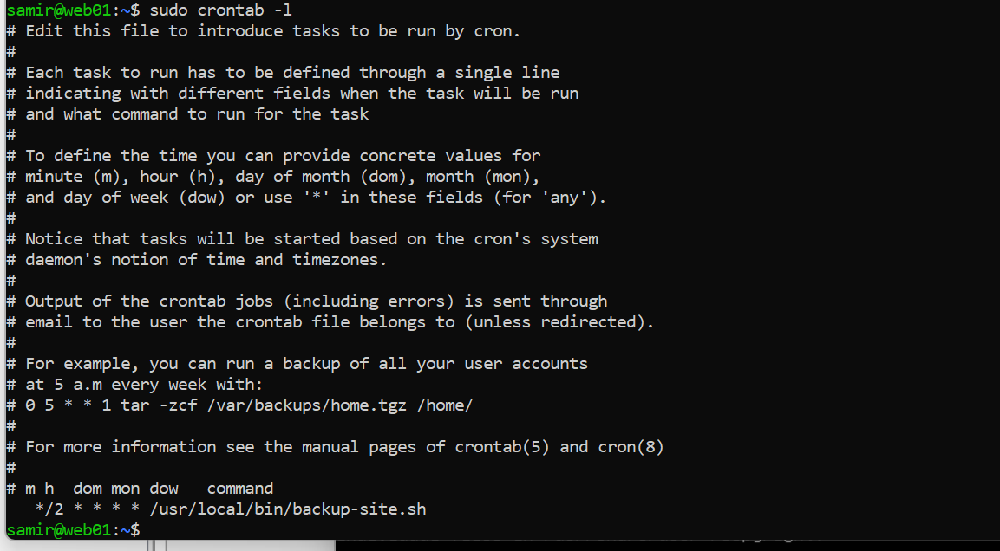
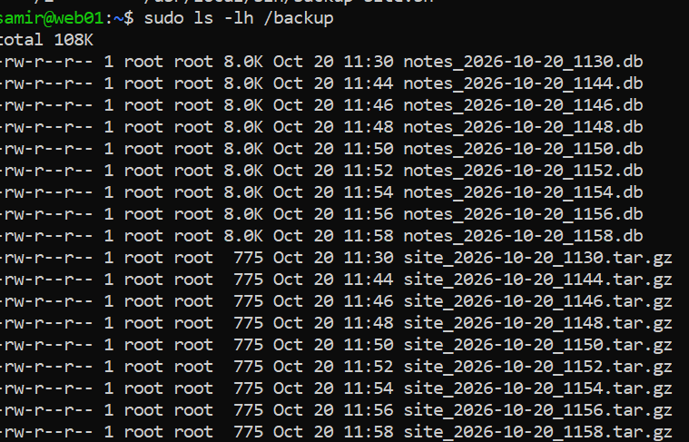

## 4. Restore test

A backup is only proven once it has been restored.

**Simulated disaster** – the database is deleted:

```bash
sudo rm /var/www/data/notes.db
```

The site loads but is empty. (PHP recreates an empty database because of `CREATE TABLE IF NOT EXISTS`, so there is no error – just no data.)

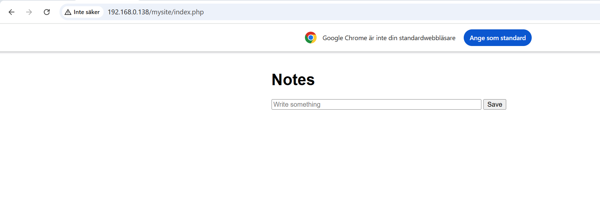

**Restore** from the latest backup:

```bash
sudo cp /backup/notes_2026-10-20_1158.db /var/www/data/notes.db
sudo chown www-data:www-data /var/www/data/notes.db
```

All notes are back.

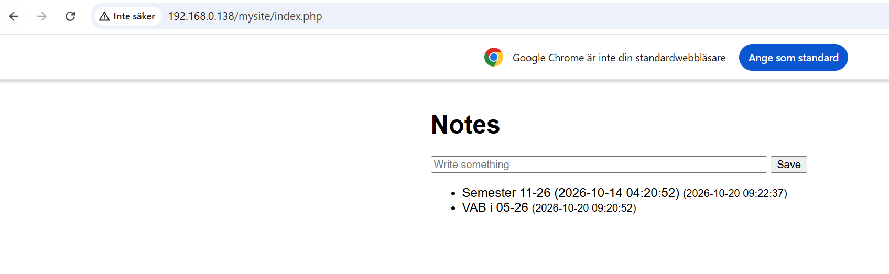

## 5. Off-site copy to backup01

Backups stored on the same server as the site are lost if that server fails. A second VM, `backup01`, receives a copy of every backup.

```
web01 (192.168.0.138)                     backup01 (192.168.0.140)
/backup/  ── rsync over SSH (key) ──────▶  /backups/web01/
```

**On backup01** – create the receiving folder:

```bash
sudo mkdir -p /backups/web01
sudo chown samir:samir /backups/web01
```

**On web01** – SSH key for passwordless login. The backup runs as root via cron, so the key is created for **root**, without a passphrase:

```bash
sudo ssh-keygen -t ed25519 -C "web01-backup01"
sudo ssh-copy-id samir@192.168.0.140
sudo ssh samir@192.168.0.140 hostname     # prints "backup01" without a password
```

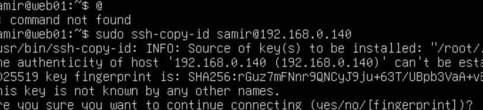

**Manual rsync test:**

```bash
sudo rsync -av /backup/ samir@192.168.0.140:/backups/web01/
```

| Part | Meaning |
|---|---|
| `-a` | Archive mode – recursive, keeps permissions and timestamps |
| `-v` | Shows each file copied |
| `/backup/` | Source on web01 – the trailing `/` copies the folder's *contents* |
| `samir@192.168.0.140:` | Log in to backup01 as `samir` |
| `/backups/web01/` | Destination on backup01 |

rsync only transfers new or changed files, so daily runs are fast.

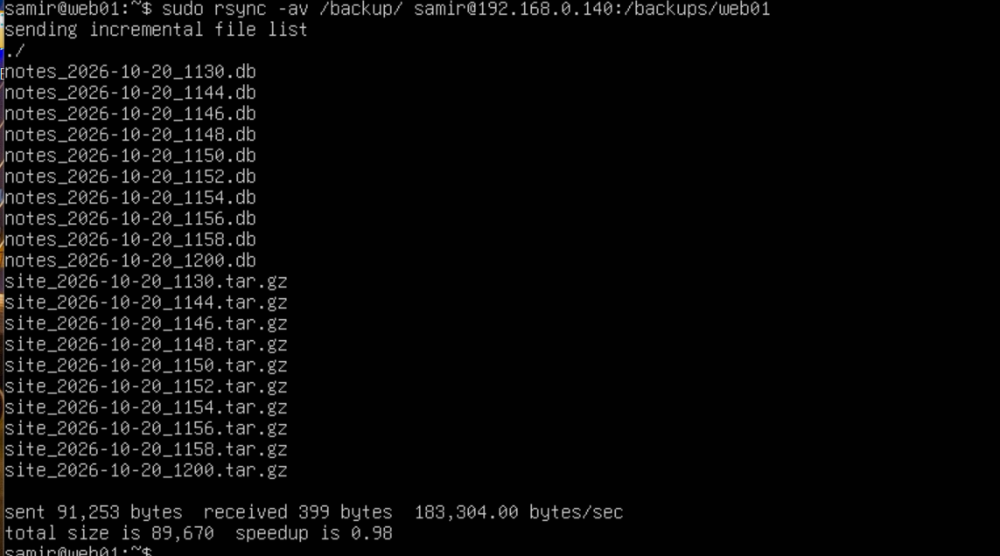

**Added to the backup script** – the off-site copy runs automatically after every backup and logs success or failure:

```bash
if rsync -a /backup/ samir@192.168.0.140:/backups/web01/; then
    echo "$(date '+%F %T') Off-site copy OK -> backup01" >> $LOG
else
    echo "$(date '+%F %T') Off-site copy FAILED -> backup01" >> $LOG
fi
```

**Result** – one run of the script creates the backup on web01 and copies it to backup01:

```
2026-10-23 09:20:38 Backup OK: notes_2026-10-23_0920.db, site_2026-10-23_0920.tar.gz
2026-10-23 09:20:38 Off-site copy OK -> backup01
```

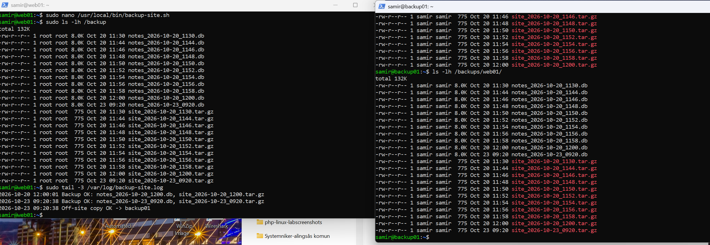

## Repository structure

```
linux-backup-lab/
├── README.md
├── app/index.php
├── scripts/backup-site.sh
└── screenshots/
```
